# Database design

PostgreSQL is the authoritative store. All timestamps are UTC `timestamptz` values written by
Prisma. Money uses `NUMERIC(14,2)`; quantities use `NUMERIC(14,3)`. Primary keys are UUIDs except
`Permission.key`, `SystemSetting.id`, and the session table.

## ER diagram

```mermaid
erDiagram
  User ||--o| Customer : "profile"
  User ||--o{ PasswordResetToken : has
  User ||--o{ UserPermissionOverride : has
  User ||--o{ UserWarehouseAssignment : assigned
  User ||--o{ Notification : receives
  User ||--o{ AuditLog : acts
  User ||--o{ CustomerOrder : places
  User ||--o{ CustomerOrder : processes
  User ||--o{ PurchaseOrder : creates
  User ||--o{ StockAdjustment : requests
  User ||--o{ StockTransfer : requests

  Permission ||--o{ RolePermission : granted
  Permission ||--o{ UserPermissionOverride : overridden

  Category ||--o{ Category : parent
  Category ||--o{ Product : contains
  Product ||--o{ ProductImage : has
  Product ||--o{ InventoryBalance : balanced
  Product ||--o{ StockMovement : moves
  Product ||--o{ StockReservation : reserves
  Product ||--o{ SupplierProduct : sourced
  Product ||--o{ PurchaseOrderItem : ordered
  Product ||--o{ GoodsReceiptItem : received
  Product ||--o{ CustomerOrderItem : sold
  Product ||--o{ StockAdjustment : adjusts
  Product ||--o{ StockTransferItem : transfers
  Product ||--o{ ReturnItem : returned

  Warehouse ||--o{ WarehouseLocation : contains
  Warehouse ||--o{ UserWarehouseAssignment : scoped
  Warehouse ||--o{ InventoryBalance : holds
  Warehouse ||--o{ StockMovement : records
  Warehouse ||--o{ PurchaseOrder : receives
  Warehouse ||--o{ GoodsReceipt : receives
  Warehouse ||--o{ CustomerOrder : fulfills
  Warehouse ||--o{ StockReservation : reserves
  Warehouse ||--o{ StockAdjustment : adjusts
  Warehouse ||--o{ StockTransfer : from_to

  Supplier ||--o{ SupplierProduct : offers
  Supplier ||--o{ PurchaseOrder : supplies
  PurchaseOrder ||--o{ PurchaseOrderItem : contains
  PurchaseOrder ||--o{ GoodsReceipt : fulfills
  GoodsReceipt ||--o{ GoodsReceiptItem : contains
  PurchaseOrderItem ||--o{ GoodsReceiptItem : received

  CustomerOrder ||--o{ CustomerOrderItem : contains
  CustomerOrder ||--o{ StockReservation : holds
  CustomerOrder ||--o{ Return : returns
  CustomerOrderItem ||--o{ ReturnItem : returned
  Return ||--o{ ReturnItem : contains

  StockTransfer ||--o{ StockTransferItem : contains
```



## Entities and invariants

| Table | Key constraints / rules |
|---|---|
| `User` | unique email; exactly one `Role`; inactive users cannot authenticate; last active Super Admin protected in application logic |
| `session` | `sid` primary key, JSON payload, expiry index; sessions revoked by deleting rows |
| `Permission` / `RolePermission` | permission catalog mirrored into the DB; composite PK `(role, permissionKey)` |
| `UserPermissionOverride` | unique `(userId, permissionKey)`; `ALLOW` or `DENY`; DENY wins |
| `Customer` | one-to-one with a Customer User; addresses and company details |
| `Product` | unique SKU and optional unique barcode; non-negative prices; soft-archive via `isActive`/`archivedAt`; category FK `ON DELETE RESTRICT` |
| `Category` | unique slug; self-referencing parent with `RESTRICT`; deactivation blocked while active products reference it |
| `Warehouse` | unique code; balances and movements are `RESTRICT`-referenced |
| `UserWarehouseAssignment` | unique `(userId, warehouseId)`; the scope boundary for Staff reads/actions |
| `InventoryBalance` | unique `(productId, warehouseId)`; `onHand >= reserved >= 0` enforced by services; stores `avgCost` |
| `StockMovement` | append-only; signed quantity, unit cost, balance-after, reference; indexes on product/warehouse/date and reference |
| `Supplier` / `SupplierProduct` | unique `(supplierId, productId)`; costs never exposed without permission |
| `PurchaseOrder` / `PurchaseOrderItem` | unique PO number; status machine; received qty cannot exceed ordered qty |
| `GoodsReceipt` / `GoodsReceiptItem` | confirmed receipts are the only purchase path that increases On-hand |
| `CustomerOrder` / `CustomerOrderItem` | unique order number; price and tax snapshotted on the item; status machine |
| `StockReservation` | unique `(orderId, productId, warehouseId)`; ACTIVE/RELEASED/CONSUMED |
| `Return` / `ReturnItem` | quantities cannot exceed delivered minus prior returns; optional restock |
| `StockAdjustment` | PENDING/APPROVED/REJECTED; reason mandatory; self-approval blocked for non-Super-Admins |
| `StockTransfer` | PENDING/APPROVED/COMPLETED/REJECTED; completion moves stock at source average cost |
| `AuditLog` | append-only; actor, action, entity, before/after JSON, IP, user agent |
| `Notification` | per-user in-app notifications |
| `SystemSetting` | singleton (`id = 1`): currency, tax, negative-stock policy, approval limit |

## Transactional hotspots

1. **Confirmation** locks the order row and balance rows, checks Available, writes reservations and
   updates Reserved. Tested under concurrent confirmation (one succeeds, one 409).
2. **Dispatch** consumes reservations and applies ISSUE movements in the same transaction.
3. **Goods receipt** locks the purchase order, validates outstanding quantities, creates the
   receipt, updates received quantities/status, and applies RECEIPT movements atomically.
4. **Transfer completion** locks both sides and writes paired `TRANSFER_OUT` / `TRANSFER_IN`
   movements at the same unit cost.
5. **Adjustment approval** locks the balance, computes the signed delta, and writes one movement.

## Indexing

Indexes exist on every foreign key used in list queries, plus:
`User(role,status)`, `Product(isActive)`, `Product(name)`, `InventoryBalance(productId)`,
`InventoryBalance(warehouseId)`, `StockMovement(productId,createdAt)`,
`StockMovement(warehouseId,createdAt)`, `StockMovement(referenceType,referenceId)`,
`CustomerOrder(customerId,createdAt)`, `CustomerOrder(status)`, `CustomerOrder(placedAt)`,
`StockReservation(status)`, `AuditLog(createdAt)`, `Notification(userId,isRead)`.

## Migrations and seed

```bash
npx prisma migrate dev --name <change>   # development
npx prisma migrate deploy                # containers / production (entrypoint does this)
npm run db:seed                          # idempotent bootstrap + demo data
```

Migrations live in `apps/api/prisma/migrations/`. The seed is idempotent: it upserts permissions,
role defaults, settings, demo users, warehouses, products with opening stock, a supplier, an
approved PO, and a pending customer order. Opening stock is written through the real movement
service, so balances and the ledger stay consistent.

The Super Admin is created once via `npm run create-super-admin` (or the seed when
`BOOTSTRAP_SUPER_ADMIN_EMAIL/PASSWORD` are set). The bootstrap refuses to run if any Super Admin
already exists and never resets an existing password. Subsequent seed runs leave it untouched.
